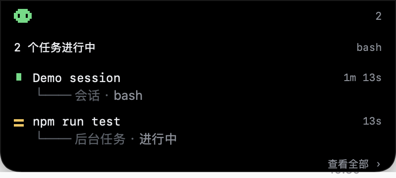

# 栖岛 Perch

A Dynamic-Island-style status panel for [DeepSeek Harness](https://github.com/deepseek-ai/dsh) that lives **in the macOS notch**, not inside the DSH window.

Collapsed, it merges with the camera housing: a pixel creature in the left wing, the running-task count in the right wing. Hover it, click it, or press <kbd>⌥⌘P</kbd> and it unfolds into the task list. When a task finishes it shows a completion card, posts a system notification and can speak the reminder out loud.




## What it shows

Everything is derived from projections DSH's browser half already maintains — no session event is ever appended, nothing is polled:

| Row kind | Source |
|---|---|
| Session | catalogued sessions whose turn is open (`running` projection, the binding's snapshot, or an open `turn/start` in the event window) |
| Job | the `jobs` client service roster (whole-set replacement stream) |
| Subagent | catalogue rows with `origin: 'subagent'` |

Each row shows the readable title, the elapsed time and the current action (tool name, step ordinal or "working"), folded from `turn/start`, `step/start`, `tool/call` and `tool/result`.

## Requirements

- macOS 13 or newer. The screen-level panel is a small AppKit helper (no Dock icon, no focus stealing).
- DSH 0.2.2 or newer, desktop profile.
- The helper is bundled prebuilt; rebuilding it needs the Xcode command line tools.

## Install

From the DSH plugin manager:

1. Copy this repository's absolute path and add it as a local bundle (**Plugins → Add plugin**), or install it with `install_bundle`, or install straight from the market entry.
2. The plugin row appears under **Plugins**; the notch panel shows up immediately.

The plugin launches the helper on startup (`open -g overlay/PerchOverlay.app`). If you quit the helper, restart DSH or launch it again by hand.

## Settings

Right-click the notch panel → **设置… / Settings…**:

- system notification banner on/off
- spoken reminder on/off
- voice per language (the system's installed voices; enhanced/premium ones sound better)
- speech rate
- one reminder line per language, picked by DSH's active UI language
- restore defaults

Everything applies immediately — no restart. Settings are stored in the helper's `UserDefaults` (`local.perch.overlay`); the bundle patch only seeds the first run.

The completion banner is posted by the DSH page itself (`Notification` API), because macOS refuses notifications from an ad-hoc signed helper. That means **System Settings → Notifications → DeepSeek Harness must allow notifications**, or the banner stays silent. The spoken reminder does not need any permission.

## Configuration

`cordis.patch.yml` carries the seed values (`config.notify`, `config.text`, `config.overlay`). `overlay: false` disables the screen-level panel entirely.

```yaml
config:
  overlay: true
  notify:
    system: true
    voice: true
  text:
    zh: 任务完成
    en: Task complete
```

The patch is composed at DSH startup: edit it, then restart DSH. Runtime edits can leave the row unaddressable.

## How it is built

| File | Role |
|---|---|
| `client.js` | Browser half: aggregates running work, posts presentation-ready JSON to `127.0.0.1:47823`, posts the completion banner, serves nothing to the DOM |
| `index.js` | Host half: launches the helper, forwards `config.notify` to it, retries + 30s heartbeat |
| `overlay/main.swift` | The AppKit helper: notch-shaped panel, `NSTrackingArea` hover, ⌥⌘P hotkey, right-click menu, settings window, TTS, `POST /state` + `GET /settings` |
| `locale/*.json` | Plugins page metadata (zh/en) |
| `icon.svg` | Original pixel-notch icon |

Rebuild the helper after editing `overlay/main.swift`:

```sh
cd overlay
swiftc -O -swift-version 5 -target arm64-apple-macos13.0 main.swift \
  -o PerchOverlay.app/Contents/MacOS/PerchOverlay
codesign --force --sign - PerchOverlay.app
```

Helper log: `~/Library/Logs/PerchOverlay.log` (trimmed at 256 KiB) — useful to see `settings`, `state`, `speech` lines.

## Limitations

- The panel is drawn *below* the camera housing, not over it: the notch's pixels are physically unavailable.
- macOS reserves Siri's natural voices for Siri; they are filtered out because selecting one silently falls back to the default voice.
- Clicking a row brings DSH to the front. A separate process cannot deep-link to one session.
- The helper is ad-hoc signed, so macOS does not let it post notifications; that is why the banner comes from the DSH app instead.

## License

MIT. The pixel creature, markers and icon are drawn for this project.
